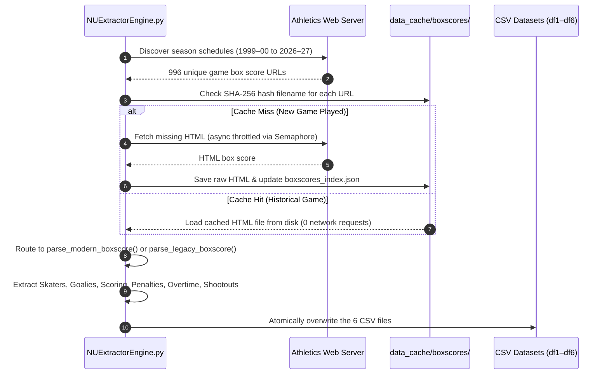
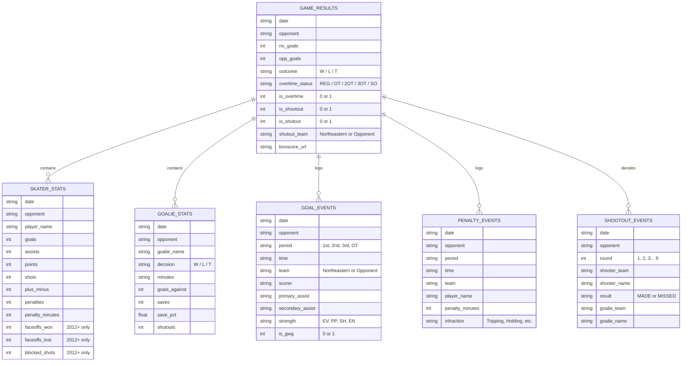
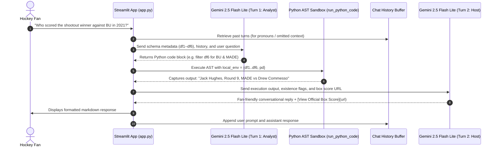
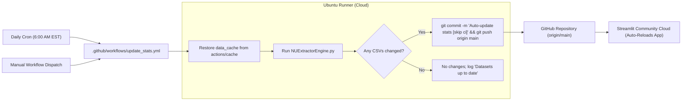

# Northeastern Men's Hockey Analytics Platform: Architecture & Data Flow

This document details the complete end-to-end architecture, data pipeline, and runtime flow of the repository. Use this reference whenever you need to debug a data mismatch, inspect an LLM reasoning error, or trace an automated update.

---

## 1. High-Level System Architecture

The project consists of three primary subsystems:
1. **The Ingestion Pipeline** (`NUExtractorEngine.py`): Web scraper and caching engine converting unstructured HTML box scores into 6 structured CSV tables.
2. **The Cloud Automation Loop** (`.github/workflows/update_stats.yml`): GitHub Actions cron job keeping datasets up-to-date daily and auto-triggering Streamlit Cloud redeployments.
3. **The Interactive Explorer** (`app.py`): Two-turn LLM reasoning agent powered by Gemini 2.5 Flash Lite executing Python pandas code in an AST sandbox to answer user questions.

```mermaid
flowchart TD
    subgraph DataSources["External Athletic Archives"]
        NU["nuhuskies.com (2012–Present Sidearm)"]
        GONU["static.gonu.com (1999–2012 Legacy)"]
    end

    subgraph Pipeline["Ingestion & Scraping Pipeline (NUExtractorEngine.py)"]
        Discover["URL Discovery (1999–2027)"]
        Cache["HTML Cache (data_cache/boxscores/)"]
        ParseMod["Modern Parser (Sidearm)"]
        ParseLeg["Legacy Parser (HTML/Text)"]
    end

    subgraph DataStore["Normalized Relational CSVs"]
        CSV1["df1: northeastern_hockey_stats_mcp.csv (Skaters)"]
        CSV2["df2: northeastern_goalie_stats.csv (Goalies)"]
        CSV3["df3: northeastern_goal_events.csv (Goals & GWGs)"]
        CSV4["df4: northeastern_penalty_events.csv (Penalties)"]
        CSV5["df5: northeastern_game_results.csv (Outcomes/OT/Shutouts)"]
        CSV6["df6: northeastern_shootout_events.csv (Shootout Attempts)"]
    end

    subgraph CloudCI["Cloud Sync & Automation"]
        GHA[".github/workflows/update_stats.yml (Daily Cron 6 AM EST)"]
        GitRepo["GitHub Repo (origin/main)"]
    end

    subgraph StreamlitApp["User Interface (app.py)"]
        UI["Streamlit UI (Logo + Disclaimer Expander)"]
        Turn1["Turn 1: Gemini Code Generation (AST Code Block)"]
        AST["Python ast.parse Sandbox Execution"]
        Turn2["Turn 2: Natural Language Synthesis & Verification"]
    end

    NU --> Discover
    GONU --> Discover
    Discover --> Cache
    Cache --> ParseMod
    Cache --> ParseLeg
    ParseMod --> DataStore
    ParseLeg --> DataStore

    DataStore --> GitRepo
    GHA -->|Scheduled Scrape| Pipeline
    GitRepo -->|Auto Redeploy| UI
    DataStore -->|load_data()| UI

    UI --> Turn1
    Turn1 --> AST
    AST --> Turn2
    Turn2 --> UI
```

---

## 2. Ingestion & Extraction Pipeline Flow (`NUExtractorEngine.py`)

The extraction pipeline is fully asynchronous and protected by an incremental file-hash cache.



### Key Functions in `NUExtractorEngine.py`
- `gather_all_game_urls(client)`: Scans all 28 season archive pages on `nuhuskies.com` and `static.gonu.com`.
- `fetch_or_load_html(client, semaphore, url, index)`: Checks if `url_to_filename(url)` exists in `data_cache/boxscores/`. If yes, returns it instantly; if no, downloads it using `httpx.AsyncClient` throttled to 25 concurrent connections.
- `parse_modern_boxscore(soup, url, html)`:
  - Extracts skaters (`goals`, `assists`, `points`, `shots`, `plus_minus`, `penalties`, `faceoffs_won`, `faceoffs_lost`, `blocked_shots`).
  - Extracts goalies (`decision`, `minutes`, `goals_against`, `saves`, `shutouts`).
  - Identifies Game-Winning Goals (`is_gwg`): matches the $(opp\_goals + 1)$-th Northeastern goal.
  - Identifies shootout events: scans play-by-play text with regex `Shootout attempt by {TEAM} {SHOOTER} {MADE|MISSED} against {OPP_TEAM} goalie {GOALIE}`.
  - Detects overtime periods (`OT`, `2OT`, `3OT`).
- `parse_legacy_boxscore(soup, url, html)`:
  - Parses pre-2012 non-Sidearm layout.
  - Standardizes period names using strict boundary matching (`1st`, `2nd`, `3rd`, `OT`) to prevent false overtime classifications.

---

## 3. Data Schema & Relationships

The app loads 6 relational DataFrames into memory via `@st.cache_data`. All tables share the composite key `['date', 'opponent', 'boxscore_url']`.



---

## 4. Dual-Turn LLM Reasoning Loop (`app.py`)

Rather than relying on brittle ReAct agent frameworks, `app.py` uses a deterministic 2-turn pipeline:



### Safety & Guardrails Built Into `app.py`:
1. **Existence Verification**: The Turn 1 code prompt forces Gemini to check if player and opponent names actually exist in the tables (`player_exists: True/False`, `opponent_exists: True/False`). If either is `False`, the agent gracefully explains that no matching records exist rather than inventing numbers or reporting a false "0".
2. **AST Execution Sandbox**: `ast.parse` separates expression evaluation from statement execution with `contextlib.redirect_stdout`, catching syntax errors and executing without synthetic tool call errors.
3. **Automatic Code Retry**: If Turn 1 code produces a runtime exception, `app.py` catches the error and sends the traceback back to the LLM to auto-correct itself in a single retry turn.

---

## 5. Cloud Automation & Continuous Deployment

The repository uses GitHub Actions as an automated serverless cron daemon:



---

## 6. Self-Debugging & Troubleshooting Guide

### Issue A: "A newly played game isn't showing up in the app"
1. **Check GitHub Actions**:
   - Navigate to [`github.com/timmyg2034/NortheasternProject/actions`](https://github.com/timmyg2034/NortheasternProject/actions).
   - If the morning run hasn't triggered yet, click **Auto-Update Hockey Stats** -> **Run workflow**.
2. **Inspect Scraper Output**:
   - Check the run logs under the `Run extraction pipeline` step.
   - Verify that the game's box score URL is listed under the season total count.
3. **Verify Local Cache**:
   - To force a re-fetch of an incomplete box score locally, delete its entry in `data_cache/boxscores_index.json` or delete the file from `data_cache/boxscores/`.

### Issue B: "Opponent name isn't grouping correctly"
- Both `app.py` and `NUExtractorEngine.py` have a centralized function: `clean_opponent_name(name)`.
- If an opponent appears under two headers (e.g. `"No. 5 Maine"` vs `"Maine"`), check `clean_opponent_name` in [`app.py`](file:///c:/Users/bball/NortheasternProject/app.py#L53) to verify that regex stripping handles the prefix.

### Issue C: "The LLM generates incorrect code for a metric"
- Check the table documentation in `code_prompt` inside [`app.py`](file:///c:/Users/bball/NortheasternProject/app.py#L270).
- Variable mappings:
  - `df1`: Skater box scores (`player_name`, `goals`, `assists`, `points`, `shots`, `plus_minus`, `penalties`, `faceoffs_won`, `blocked_shots`)
  - `df2`: Goalie box scores (`goalie_name`, `decision`, `saves`, `goals_against`, `shutouts`)
  - `df3`: Goal timeline & GWGs (`scorer`, `primary_assist`, `is_gwg`, `strength`)
  - `df4`: Penalty infractions (`player_name`, `penalty_minutes`, `infraction`)
  - `df5`: Game results & overtime (`outcome`, `overtime_status`, `is_overtime`, `is_shutout`, `shutout_team`)
  - `df6`: Shootout shot-by-shot attempts (`round`, `shooter_name`, `result`, `goalie_name`)

---

## 7. File Directory Map

```
c:\Users\bball\NortheasternProject\
├── .github/
│   └── workflows/
│       └── update_stats.yml            <-- GitHub Actions cloud cron job
├── data_cache/
│   ├── boxscores/                      <-- Cached HTML box scores (SHA-256 filenames)
│   └── boxscores_index.json            <-- URL-to-filename hash mapping
├── app.py                              <-- Main Streamlit application & 2-turn Gemini agent
├── NUExtractorEngine.py                <-- Unified scraping engine (Sidearm + Legacy)
├── generate_master_notebook_doc.py     <-- Skater Markdown documentation generator
├── generate_goalie_master_doc.py       <-- Goalie Markdown documentation generator
├── mcp_hockey_server.py                <-- Local FastMCP tool server
├── nu_husky_logo.png                   <-- Transparent Northeastern Husky logo
├── requirements.txt                    <-- Streamlit Cloud dependency manifest
├── northeastern_hockey_stats_mcp.csv   <-- Skater stats (1999–present, ~18k rows)
├── northeastern_goalie_stats.csv       <-- Goalie stats (1999–present, 1,040 rows)
├── northeastern_goal_events.csv        <-- Goal timeline & GWGs (6,283 events)
├── northeastern_penalty_events.csv     <-- Penalty records (16,739 events)
├── northeastern_game_results.csv       <-- Game outcomes, OT, and shutouts (981 games)
└── northeastern_shootout_events.csv    <-- Shootout shot attempts (102 shots)
```
