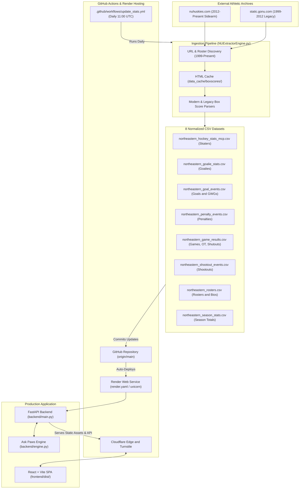
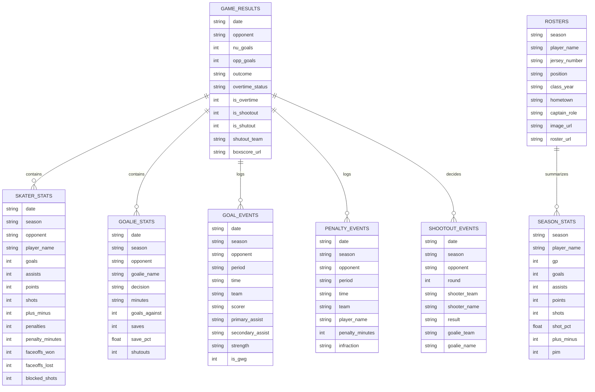
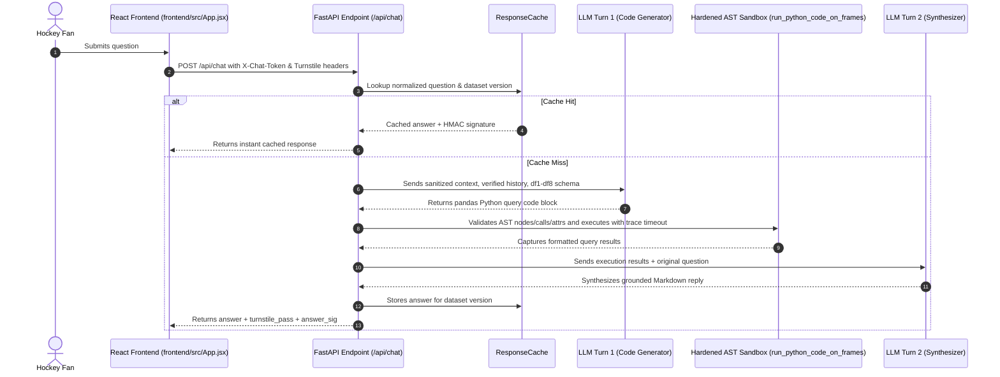
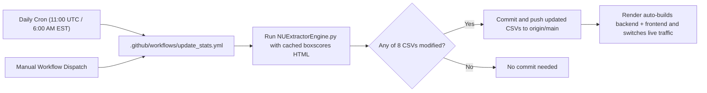

# Northeastern Men's Hockey Analytics Platform: Architecture & Data Flow

This document details the end-to-end architecture, data pipeline, and runtime flow of the **Northeastern Men's Hockey Stats Explorer** ("DogHouse Stats Explorer"). Use it as a reference when debugging data mismatches, tracing API or LLM behavior, or maintaining Render deployment and GitHub Actions automation.

---

## 1. High-Level System Architecture

The platform consists of four coordinated subsystems:

1. **Ingestion & Scraping Pipeline** (`NUExtractorEngine.py`): Asynchronous web scraper and file-hash HTML cache converting Sidearm and legacy athletics box scores, rosters, and season aggregates into 8 structured CSV datasets.
2. **Cloud Automation Loop** (`.github/workflows/update_stats.yml`): Daily GitHub Actions cron job running `NUExtractorEngine.py` and committing updated CSVs to `origin/main` so Render auto-deploys fresh data.
3. **FastAPI Backend & Query Engine** (`backend/main.py`, `backend/engine.py`): Serves REST analytics endpoints (`/api/*`), static SPA bundles (`frontend/dist/`), SSRF-safe image proxying, Cloudflare Turnstile & sliding-window rate limiting, and the two-turn Ask Paws AI agent running in a hardened Python AST sandbox.
4. **React + Vite Frontend** (`frontend/`): Single-page application featuring Ask Paws AI chat, Stats & Team Leaders, Program Record Book & Chemistry, Rosters, Opponent Rivalries, Beanpot Hub, Side-by-Side Player Comparison, and Box Score modals, hosted on **Render** behind **Cloudflare**.



---

## 2. Deployment Architecture (Render + Docker)

### Render Service (`render.yaml`)
- **Build Command**: `pip install -r requirements.txt && npm --prefix frontend ci && npm --prefix frontend run build`
- **Start Command**: `uvicorn backend.main:app --host 0.0.0.0 --port $PORT`
- **Health Check**: `GET /api/health`
- **Environment Configuration**:
  - LLM keys & quotas (`GEMINI_API_KEY`, `GEMINI_API_KEYS`, fallback providers, `MAX_DAILY_LLM_CALLS`)
  - Rate limits (`CHAT_RATE_LIMIT_PER_MIN`, `CHAT_RATE_LIMIT_PER_HOUR`, `CHAT_RATE_LIMIT_PER_DAY`)
  - Bot & edge security (`TURNSTILE_SITE_KEY`, `TURNSTILE_SECRET_KEY`, `FRONTEND_ORIGINS`, `RENDER_EXTERNAL_URL`, `RENDER_EXTERNAL_HOSTNAME`)
  - Client IP resolution (`_get_client_ip` validates reverse-proxy headers and only trusts `CF-Connecting-IP` / `True-Client-IP` when `CF-Ray` accompanies a verified Cloudflare peer/forwarded IP).

### Container Build (`Dockerfile`)
- **Stage 1 (`frontend-build`)**: `node:20-slim` installs `frontend/package*.json` via `npm ci` and outputs production assets to `/app/frontend/dist`.
- **Stage 2 (`python:3.11-slim`)**: Installs `requirements.txt`, copies `backend/`, CSV datasets, and `frontend/dist/`, and runs `uvicorn backend.main:app --host 0.0.0.0 --port ${PORT:-7860}` as non-root `appuser`.

---

## 3. Data Schema & Datasets (8 CSV Tables)

`load_datasets()` in `backend/engine.py` loads and normalizes 8 CSV datasets into memory during FastAPI startup (`lifespan`), computing a SHA-256 dataset version (`_compute_dataset_version`) to invalidate cached chat answers whenever datasets update:



---

## 4. Ask Paws Two-Turn AI Pipeline (`backend/engine.py` + `backend/main.py`)

Interactive AI chat runs behind Cloudflare Turnstile verification, HMAC-signed short-lived chat tokens (`ChatTokenManager`, `TurnstileSessionManager`), sliding-window IP rate limiters, and daily LLM budget caps:



### Key Guardrails
- **Hardened Python AST Sandbox (`run_python_code_on_frames`)**: Rejects disallowed AST syntax/imports/dunders, wraps `pd` and `re` in read-only `_SafeModuleProxy` instances, bounds `range()` and exponentiation, isolates execution over deep-copied DataFrames via `pd.option_context(...)`, and enforces a `sys.settrace` CPU/step budget (`_SandboxTimeout`).
- **Prompt Injection Defense**: Page context and conversation history are sanitized, length-bounded, HMAC-signed (`sig`) across assistant turns, and delimited inside `<page_context>`, `<conversation_history>`, and `<user_question>` tags.
- **SSRF-Protected Image Proxy (`/api/image-proxy`)**: Validates URLs against private/loopback/link-local ranges, re-validates up to 3 redirects, blocks SVG MIME types, enforces a 5 MB download limit and `Image.MAX_IMAGE_PIXELS`, and caches resized WebP/PNG assets in a bounded LRU cache.

---

## 5. Cloud Automation & Continuous Deployment



---

## 6. Self-Debugging & Troubleshooting Guide

### Issue A: "A newly played game isn't showing up on the site"
1. **Check GitHub Actions**: Inspect the **Auto-Update Hockey Stats** workflow (`.github/workflows/update_stats.yml`) and trigger a manual run if the daily run hasn't executed yet.
2. **Inspect Scraper Logs**: Check `python NUExtractorEngine.py` output to verify the new box score URL was discovered and parsed into the CSVs.
3. **Inspect Render Deploy & Health Check**: Verify Render built the latest `origin/main` commit and `GET /api/health` reports the expected `games_count` and `latest_game_date`.

### Issue B: "Opponent name isn't grouping correctly"
- `NUExtractorEngine.py` (`clean_opponent_name`) and `backend/engine.py` centralize opponent name normalization (stripping rankings, venue notes, and normalizing aliases). Verify normalization rules in both files and re-run extraction if raw CSV entries differ.

### Issue C: "Ask Paws returns wrong stats or hits sandbox restrictions"
- Check the `df1`–`df8` schema prompt and sandbox allowlists in `backend/engine.py` (`answer_question` and `run_python_code_on_frames`).
- Check Render logs for `[AI fallback]` or `Error code` warnings (client errors intentionally return sanitized messages while full provider details are logged server-side).

---

## 7. Repository Directory Map

```
NortheasternProject/
├── .devcontainer/
│   └── devcontainer.json               # Codespaces / Dev Container (FastAPI + Vite + Node 20)
├── .github/
│   └── workflows/
│       └── update_stats.yml            # Daily cron job running NUExtractorEngine.py
├── backend/
│   ├── __init__.py
│   ├── engine.py                       # Dataset loader, ResponseCache, LLM pipeline, AST sandbox
│   ├── main.py                         # FastAPI app, REST APIs, security middleware, SPA serving
│   └── requirements.txt                # Backend dependency manifest
├── docs/
│   ├── architecture_and_data_flow.md   # Platform architecture & data flow guide
│   ├── PROJECT_CONTEXT_AND_CHAT_LOG.md # Historical development context log
│   └── chat_logs/                      # Archived session logs
├── frontend/
│   ├── public/                         # PWA manifest, service worker (sw.js), icons, robots.txt
│   ├── src/
│   │   ├── App.jsx                     # Main React SPA (Ask Paws, Stats, Records, Roster, Opponents, Beanpot, Compare, Box Scores)
│   │   ├── BugReportModal.jsx          # Accessible bug report dialog
│   │   ├── LegalModals.jsx             # Disclaimer, Privacy Policy, and Terms of Use modals
│   │   ├── main.jsx                    # React entry point
│   │   ├── opponentLogos.json          # Opponent logo asset manifest
│   │   └── styles.css                  # Design tokens and responsive layout rules
│   ├── index.html
│   ├── package.json
│   ├── package-lock.json
│   └── vite.config.js
├── Dockerfile                          # Multi-stage Node 20 + Python 3.11 non-root container build
├── NUExtractorEngine.py                # Async scraping & HTML-cached extraction pipeline
├── nu_husky_logo.png                   # Root Husky logo asset
├── render.yaml                         # Render Web Service deployment configuration
├── requirements.txt                    # Python dependency manifest (used by Render & Docker)
├── runtime.txt                         # Python runtime pin
├── northeastern_game_results.csv       # Game results, venues, OT, shootout, shutout metadata
├── northeastern_goal_events.csv        # Goal timeline, assists, strength, GWGs
├── northeastern_goalie_stats.csv       # Per-game goalie stats & decisions
├── northeastern_hockey_stats_mcp.csv   # Per-game skater box score stats
├── northeastern_penalty_events.csv     # Per-game penalty events & infractions
├── northeastern_rosters.csv            # Season rosters, jerseys, bios, captains, headshots
├── northeastern_season_stats.csv       # Official season-by-season aggregate skater & goalie stats
└── northeastern_shootout_events.csv    # Shootout round-by-round attempts & results
```
